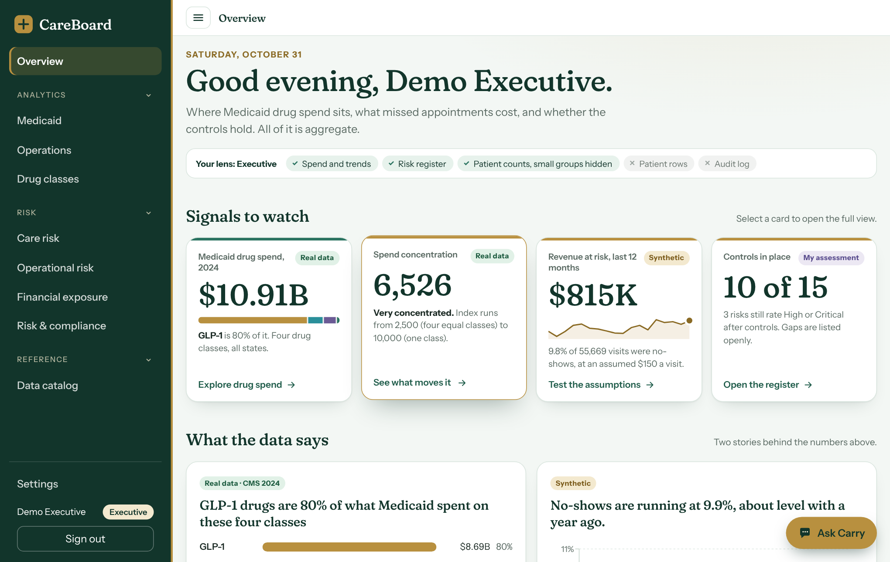
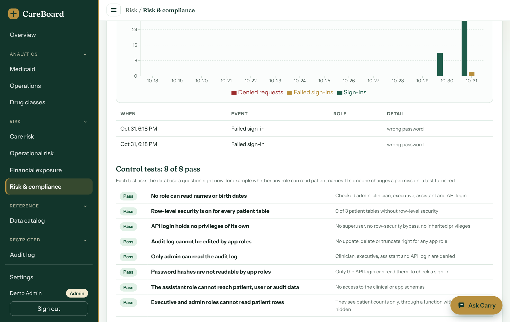
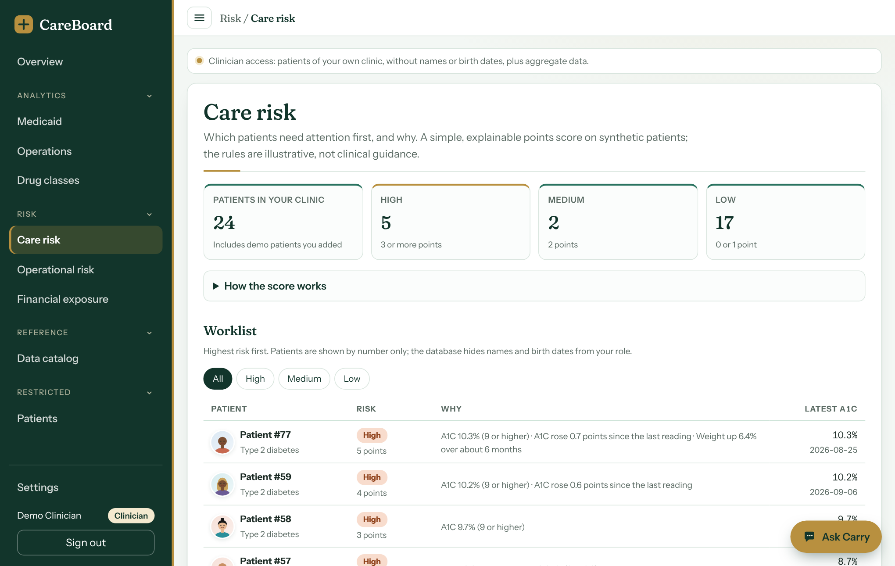
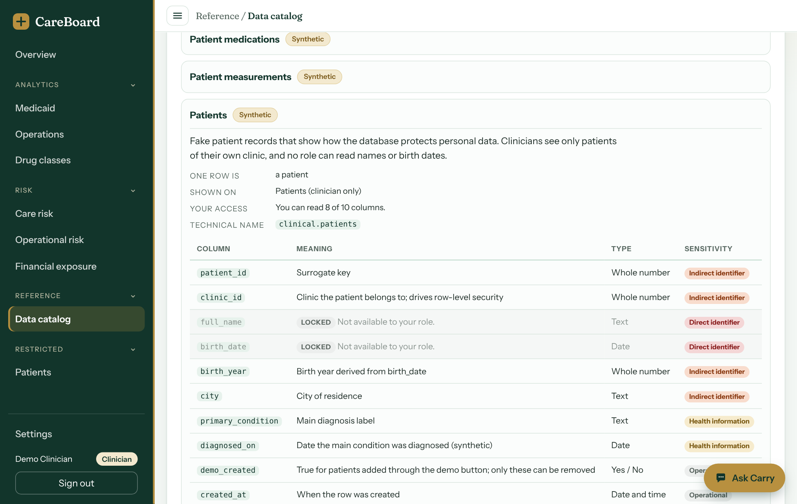
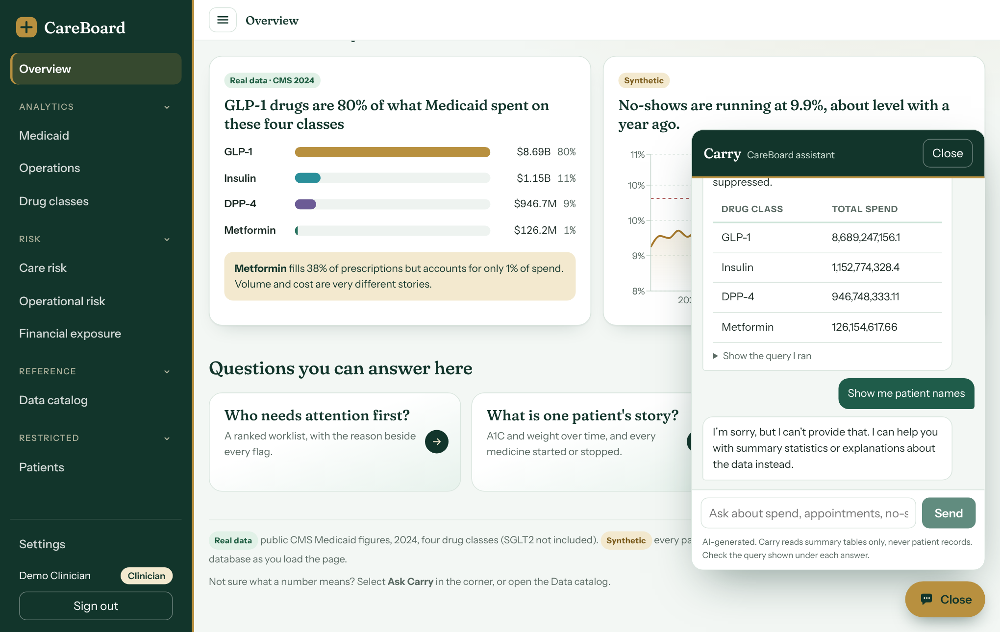

# CareBoard

A role-aware health analytics app. One dataset, three kinds of users, and a database that decides what each of them may see.

**Live demo:** https://careboard-1755.onrender.com  
The first sign-in after a quiet period can take up to a minute while the free hosting wakes up. All patient-level data is synthetic.



## What problem it answers

I built CareBoard as a mock company would brief it: a small health system with two clinics wants one place to answer business questions, without giving every employee access to everything.

| Role | Business questions the app answers | What the database refuses |
|---|---|---|
| **Executive** | Where is Medicaid drug spend concentrated? How much revenue do no-shows put at risk? What does the risk register say? | Any patient row. Small groups are hidden in the counts they do see. |
| **Clinician** | Which of my patients need attention first, and why? Who is on which drug class? | Other clinics' patients, and every patient's name and birth date. |
| **Admin** | Are the controls still working? What happened in the audit log? Is the data healthy? | Patient rows and password hashes. |

## What is in it

- **Overview, Medicaid, Operations, Drug classes.** Public Medicaid drug spend (2024) and synthetic clinic appointments, with drill-downs.
- **Care risk.** A points-based risk score per synthetic patient with the reasons shown. Clinicians get a worklist for their clinic; executives and admins get counts with small cells hidden by the database.
- **Operational risk.** Revenue at risk from no-shows, with adjustable visit value and target rate.
- **Financial exposure.** Spend concentration index, price versus volume, and a what-if slider. Scenarios, not forecasts.
- **Risk & compliance.** A 16-item risk register, a 15-item control map tied to HIPAA Security Rule areas, live security metrics, data-health checks, and 8 control tests that query the database each time the page loads.
- **Patients.** Synthetic patients with avatars, A1C and weight charts, and medication history. Clinicians can add and remove demo patients under hard limits.
- **Data catalog.** What each number means, where it comes from, a sensitivity label on every column, and which columns your role cannot read.
- **Audit log.** Sign-ins, failed sign-ins, denied requests, data views, and every question asked of the assistant.
- **Business intelligence.** A published Tableau dashboard fed by aggregate exports. See the section below.
- **Carry.** A natural-language assistant that answers questions about the aggregate data and can read nothing else.

| | |
|---|---|
|  |  |
|  |  |

## Where the signals come from

Every number on the Overview is a **signal**: one figure a person can act on. A figure is only worth trusting if you can trace it back, so this section does that for each one. The Overview also tags every signal with its origin: **Real data** (public CMS data), **Synthetic** (generated by scripts in this repository), **Live check** (queried from the database when the page loads), or **My assessment** (my own judgment, written down).

**The path every number takes**

```
Source (CMS file, or a script that generates data)
   -> load script writes it into the serving / clinical / app schemas in Postgres
   -> the API switches into the signed-in user's database role and runs a fixed query
   -> the browser does the last step of arithmetic (shares, rates, a dollar assumption)
   -> the signal card shows the figure, its tag, and a link to the page with the detail
```

### Executive

| Signal | Source | How it is calculated | Tag | What to keep in mind |
|---|---|---|---|---|
| Medicaid drug spend, 2024 | CMS State Drug Utilization Data, 2024. `api/scripts/export_medicaid.ts` reads it from my separate diabetes-glp1-pipeline project, sums by state, quarter, class and drug, and checks that the total matches that project's class summary before writing `data/medicaid_drug_quarterly.csv` | Sum of `spend` (amount reimbursed) across four classes: GLP-1, insulin, DPP-4, metformin | Real data | Four classes only. Small cells are hidden in the source, so totals can understate. Spend is before manufacturer rebates, as far as I know |
| Spend concentration | Same table | Herfindahl-Hirschman index: each class's share of spend as a percentage, squared, then summed. 10,000 means one class holds everything. With four classes the lowest possible value is 2,500 | Real data | The labels "Concentrated" (3,500 and up) and "Very concentrated" (5,000 and up) are my cutoffs, chosen for four classes, not an official standard |
| Revenue at risk, last 12 months | `serving.clinic_daily`, synthetic (see below) | No-shows in the last 365 days of data, times an assumed $150 per visit. The API returns counts only; the browser applies the dollar value | Synthetic | The $150 is an assumption, not billing data. The Operational risk page lets you change it |
| Controls in place | `app.control_map`, my own table | Controls with status Implemented or Inherited, out of 15 | My assessment | A self-review, not an audit. Gaps stay in the list |

### Clinician

| Signal | Source | How it is calculated | Tag | What to keep in mind |
|---|---|---|---|---|
| Patients in your clinic | `clinical.care_risk`, synthetic patients | Row count. Row-level security means a clinician only receives their own clinic's rows | Synthetic | Names and birth dates are unreadable by any role |
| Need attention first | `clinical.care_risk` view in `db/risk.sql` | Patients whose points total 3 or more. Points come from simple rules: latest A1C of 9 or higher scores 3, 8 to 8.9 scores 1; no A1C within 180 days (type 2 diabetes) or 365 days scores 2; an A1C rise of 0.5 or more scores 1; plus rules for a stopped GLP-1, a new insulin start and weight gain. Medium is 2 points | Synthetic | The rules are illustrative, not clinical guidance. Every flag shows the rules that fired |
| Latest A1C at 9% or higher | `clinical.patient_readings` | Count of patients whose most recent A1C is 9 or higher | Synthetic | Out of the patients with an A1C on file |
| No-show rate, last 12 months | `serving.clinic_daily` | No-shows divided by scheduled visits, last 365 days of data. The 10% target is a working assumption | Synthetic | Same table as revenue at risk |

### Admin

| Signal | Source | How it is calculated | Tag | What to keep in mind |
|---|---|---|---|---|
| Control tests passing | `app.control_tests()` | 8 queries run against the live database every time the page loads, for example "no role can read names or birth dates" | Live check | A changed permission turns a test red on the next load |
| Data health checks | `app.data_checks()` | 9 row-count, reconciliation and freshness checks | Live check | The CMS data has some cells hidden by the source's small-cell suppression, which a check reports honestly |
| Refused, last 30 days | `app.audit_log` | Failed sign-ins plus blocked requests (`access_denied`) in the last 30 days | Live check | Includes my own early password mistakes while setting up the demo |
| Known gaps | `app.control_map` | Controls with status Gap or Partial | My assessment | Listed on purpose, so the weak spots are visible |

### Why the synthetic signals show what they show

I wrote the generators, so the findings are properties of my assumptions. They are not discoveries.

- `api/scripts/generate_clinic_ops.ts` uses a fixed random seed (42). Base no-show rates are 8% for Primary care, 12% for Behavioral health and 6% for Endocrinology, with Mondays 1.5 points higher. Behavioral health drifts up by 1.5 points a year. That is why Behavioral health sits near 14% and why the overall rate creeps toward the 10% target.
- Seed patients are shaped on purpose: about one in five type 2 diabetes patients is poorly controlled, some stop a GLP-1, some start insulin, some stop having readings. That gives the risk rules something to find.
- The Medicaid figures are the only real-world signals, and they cover one year and four drug classes.

Read the clinic and patient signals as a demonstration of method: how a number is defined, protected and traced. They say nothing about real people or real clinics.

## Architecture

```
Browser (React 19 + Vite + Recharts)
   │  HTTPS, JWT (8 hours)
   ▼
Express 5 API ──────────────► Groq (Carry only: question text and aggregate results)
   │  per request:
   │  BEGIN; SET LOCAL ROLE role_<admin|clinician|executive>; set clinic id
   ▼
PostgreSQL 17 (Neon in production, Docker locally)
   ├─ serving.*   aggregate tables, readable by every role
   ├─ clinical.*  synthetic patients, medications, readings; row-level security
   ├─ app.*       users, audit log, risk register, control map, classification
   └─ roles       role_admin, role_clinician, role_executive, role_assistant (all NOLOGIN)
                  careboard_api (the only login; holds no privileges of its own)
```

The key design choice: **the API does not decide who sees what. The database does.** The API login cannot read anything. For each request it switches into the signed-in user's role, and Postgres applies that role's grants and row-level security. A bug in the API can't hand out more than the role allows.

### Data

| Dataset | Source | Notes |
|---|---|---|
| `serving.medicaid_drug_quarterly` | CMS State Drug Utilization Data, 2024, prepared by my separate diabetes-glp1-pipeline project | Four classes: GLP-1, insulin, DPP-4, metformin. SGLT2 inhibitors are not included. Small cells may be hidden in the source, so totals can understate. Spend is the amount reimbursed; as far as I know it is before manufacturer rebates. |
| `serving.clinic_daily` | **Synthetic**, fixed random seed | Daily scheduled, completed and no-show counts for 2 clinics and 3 departments, weekdays, Jan 2024 to Oct 2026. |
| `clinical.*` | **Synthetic** | 48 seeded patients (24 per clinic) plus demo-added ones. The seed shapes some patients as poorly controlled or lost to follow-up so the risk rules have something to find. These are not findings about real people. |

## How data is protected

| Control | How it works |
|---|---|
| Roles in the database | Three group roles hold the privileges. The API login has none and switches role per request. |
| Row-level security | Clinicians see only patients of their own clinic. With no clinic set, they see nothing. |
| Column grants | `full_name` and `birth_date` are readable by no role at all. |
| Audit trail | Every sign-in, failed sign-in, denied request, data view, patient add/remove and Carry question is logged. App roles can insert but never update or delete. Only admin can read. Failed sign-ins do not store what was typed. |
| Minimum cell size | Patient counts shown to executives and admins hide any group under 5, and hide a second number when needed so it can't be worked out by subtraction. Enforced inside a database function. |
| Throttles | Sign-in 30 attempts per 15 minutes per IP. Carry 20 requests per 10 minutes per IP, plus a daily cap. Adding demo patients 12 per hour, removing 40 per hour. |
| Demo write guards | A database trigger and row-level policies allow clinicians to add or remove only demo patients, in their own clinic, up to 30 per clinic. No free text is accepted. Demo patients expire after 6 hours. |
| Control tests | 8 live checks, for example "no role can read names or birth dates" and "the assistant role cannot reach patient, user or audit data". If a permission changes, a test turns red. |

### Carry, the assistant

Carry turns a question into one SQL `SELECT`, runs it, and explains the result. The model never gets database access. The query runs as `role_assistant`, which is read-only, can read two summary tables, runs inside a `READ ONLY` transaction with a 5-second timeout and a 200-row cap, and passes a SQL checker first. It has no access to the `clinical` or `app` schemas. The model is set with `GROQ_MODEL` (currently `openai/gpt-oss-20b` on Groq), and a daily question cap is set with `ASSISTANT_DAILY_LIMIT`. Questions are recorded in the audit log.

### What this is not

- It is **not HIPAA compliance**. All patient data is invented. The risk register and the HIPAA references are my own work as a learning exercise, and the references should be checked against the regulation text before anyone relies on them.
- Risk scores are my judgment on a 5×5 scale. Care-risk rules are illustrative and not clinical guidance.
- Known gaps, listed in the app on purpose: no multi-factor sign-in, no per-account lockout, tokens can't be revoked early, no idle timeout, and the database owner can still edit the audit log. Demo accounts share a published password by design.

## Business intelligence layer (Tableau)

**Published dashboard:** [CareBoard operations on Tableau Public](https://public.tableau.com/app/profile/angel.mbenoun/viz/CareBoardoperations/Dashboard1)

A second reporting surface on the same data, built to answer one operations question: where are we losing visits? It shows revenue at risk for the last 12 months, the no-show trend against the 10% target, and no-show rate by department, with a clinic filter that drives all three.

How the data gets there:

1. `api/scripts/export_bi.ts` connects as the API login, switches into `role_admin` inside a read-only transaction, and writes aggregate tables to `bi/data/` (use `--neon` for production). The database refuses patient rows to that role.
2. The script also checks every file before writing it and refuses any file that has a column named like a patient identifier (patient id, name, birth date, city, email).
3. Suppressed counts stay blank in the exports and in Tableau. They are never turned into zeros.
4. `bi/tableau/clinic_daily_flat.csv` joins the clinic fact table to its date and clinic dimensions, because Tableau Public only accepts extracts. The published workbook uses it.

**Cross-checks against the app**, so the two surfaces cannot drift apart silently: revenue at risk reads $815,400 in Tableau and $815K in the app, scheduled visits over the same 365-day window are 55,669 in both, and the latest monthly no-show rate is about 9.9% in both. The dollar value per visit ($150) and the 10% target are assumptions, labeled as such on the dashboard. All data behind it is synthetic.

## Tech stack

React 19, Vite, TypeScript, Recharts · Node, Express 5, `pg`, `helmet`, `express-rate-limit`, `bcryptjs`, `jsonwebtoken` · PostgreSQL 17 · Docker Compose (local) · Neon and Render free tiers (production) · Groq (assistant).

## Demo accounts

| Role | Email |
|---|---|
| Admin | `admin@careboard.dev` |
| Clinician (clinic 1) | `clinician@careboard.dev` |
| Executive | `executive@careboard.dev` |

Password for all three: `DEMO_PASSWORD` (demo only, protects synthetic data).

Things to try: sign in as the clinician and open **Care risk**; as the executive, open **Care risk** and notice the hidden cells; as the admin, open **Risk & compliance** and scroll to the control tests; ask Carry for patient names and watch it refuse, then find the question in the admin's **Audit log**.

## Run it locally

Prerequisites: Node 22 or newer, Docker Desktop. I have not run this from a clean clone on a second machine, so treat the steps as a checklist and tell me if one breaks.

1. Create `.env` in the repo root with `POSTGRES_PASSWORD=<choose one>`, then start the database: `docker compose up -d`. The scripts in `db/init` create the schemas, roles and tables on first start.
2. Create `api/.env` with the variables below.
3. Give the API login a password, matching `DATABASE_URL`: `docker exec -it careboard-db psql -U careboard_admin -d careboard -c "ALTER ROLE careboard_api PASSWORD '<choose one>'"`.
4. In `api`, run `npm install`, then in this order:
   ```
   npx tsx scripts/load_serving.ts       # Medicaid and clinic data from /data, plus column comments
   npx tsx src/seed.ts                   # the three demo accounts
   npx tsx scripts/apply_assistant.ts    # the read-only role for Carry
   npx tsx scripts/seed_patients.ts      # synthetic patients, medications, readings
   npx tsx scripts/apply_risk.ts         # risk register, control map, care risk view, checks
   npm start                             # API on port 4100
   ```
5. In `web`, run `npm install` and `npm run dev`, then open the address Vite prints.

`api/.env` variables (never commit this file; it is in `.gitignore`):

| Variable | Purpose |
|---|---|
| `DATABASE_URL` | Connection for the API login (`careboard_api`) |
| `ADMIN_DATABASE_URL` | Admin connection used only by setup scripts |
| `JWT_SECRET` | Signs sign-in tokens |
| `DEMO_PASSWORD` | Password given to the three demo accounts by `src/seed.ts` |
| `GROQ_API_KEY`, `GROQ_MODEL`, `ASSISTANT_DAILY_LIMIT` | Carry |
| `NEON_ADMIN_URL`, `NEON_API_PASSWORD` | Only for `--neon` scripts |

## Deploy

Production runs on a Render web service (free) and a Neon Postgres database (free). The API serves the built web app, so one service does both: build `web` with `npm run build`, then start `api` with `npm start`. Set the same variables in Render's environment settings.

**Order matters.** Apply database scripts to Neon (`--neon`) **before** pushing server code that depends on them, because Render redeploys on every push. Setup scripts for Neon: `bootstrap_neon.ts` once, then `load_serving.ts`, `apply_assistant.ts`, `seed_patients.ts` and `apply_risk.ts`, each with `--neon`.

## Repository map

```
api/src        server.ts (routes), risk.ts (risk routes), assistant.ts (Carry), sqlGuard.ts, db.ts, patientGen.ts
api/scripts    setup, loading and check scripts
db/init        schemas, roles, tables, grants
db/*.sql       patients.sql, assistant.sql, risk.sql, comments.sql (idempotent; run by the scripts)
data           Medicaid and clinic CSVs loaded into the serving schema
bi/data        aggregate CSV exports for the dashboard (no patient-level data)
bi/tableau     flat extract source for the published Tableau dashboard
web/src        pages (Overview, Medicaid, Operations, CareRisk, OpsRisk, SpendRisk, RiskCompliance, ...)
```

The plain-language dataset descriptions in the data catalog live in `web/src/catalogContent.ts` and are hand-written, so they can drift from the schema. Column descriptions come from database comments in `db/comments.sql` and cannot.

## What I would do next

Add automated tests that sign in as each role and compare row sets, schedule the data-health checks with alerts, add multi-factor sign-in and per-account lockout, and ship the audit log to storage the database owner can't edit.

## Data sources and credits

Medicaid data: Centers for Medicare & Medicaid Services, State Drug Utilization Data. Everything else, including every patient, appointment and risk score, is synthetic and generated by the scripts in this repository.
